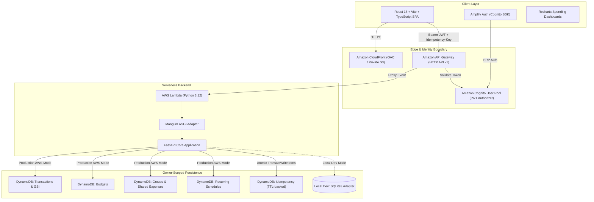
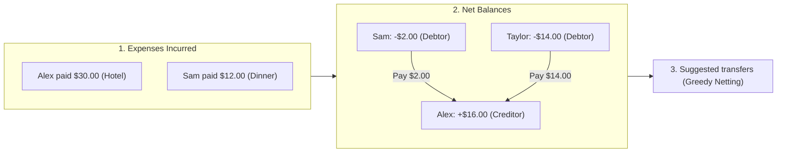

# SmartSpend

[](https://github.com/sneh20047078/smartspend/actions/workflows/ci.yml)


[](https://hub.docker.com/r/snehsp/smartspend-api)
[](https://hub.docker.com/r/snehsp/smartspend-web)

**SmartSpend** is a personal finance application for tracking income and expenses, managing budgets, and coordinating shared group spending. It is built with React and TypeScript, a FastAPI service, and an AWS serverless infrastructure definition.

> **Project status:** The frontend and API are containerized, published to Docker Hub, and validated locally with an authenticated smoke test. Automated tests and infrastructure builds pass locally. The AWS infrastructure has not been deployed to a live account; live AWS behavior and cloud end-to-end tests are unverified.

## Features

- **Transactions and dashboard:** Record income and expenses, filter and search entries, review date-scoped totals and trends, and export reports as CSV.
- **Budgets:** Set monthly or custom-period limits, monitor category progress, and view in-app threshold alerts.
- **Recurring expenses:** Create weekly or monthly schedules. Due entries are generated when an authenticated session starts or processing is requested; there is no always-on scheduler.
- **Shared expenses:** Create groups, split expenses equally or by custom amounts, and calculate suggested settlements. A suggested settlement does not record a completed payment.
- **Account preferences:** Manage profile, currency, timezone, and theme settings.
- **Authentication and data isolation:** Local development uses SQLite and local JWTs. The AWS design uses Cognito JWT verification and owner-scoped DynamoDB repositories.

## Technology

| Area | Technologies |
|---|---|
| Frontend | React 18, TypeScript, Vite, Tailwind CSS, Recharts, AWS Amplify Auth |
| API | Python 3.12, FastAPI, Pydantic, Mangum |
| Local storage | SQLite |
| AWS infrastructure | AWS SAM/CloudFormation, API Gateway, Lambda, Cognito, DynamoDB |
| Containers and CI | Docker, Docker Compose, GitHub Actions |
| Tests | Pytest, Vitest |

---

## Architecture Overview



---

## Engineering Notes

### 1. Financial Precision & Minor-Unit Math
* Financial amounts are represented as integer minor units with explicit currency codes (for example, `150000` USD minor units is `$1,500.00`).
* Monthly recurrence preserves the original day where possible and clamps to the last day of shorter months.

### 2. Distributed Concurrency & Idempotency
* **SHA-256 Request Deduplication:** Financial mutation endpoints require an `Idempotency-Key`. The backend records a SHA-256 digest of the request payload and stores it in DynamoDB with a 30-day TTL. Duplicate requests safely return cached responses or detect conflict mismatches.
* **Optimistic Concurrency Control (OCC):** Updates and deletions require an `expected_version` number, preventing lost updates and race conditions across concurrent client sessions.
* **Atomic Transactions:** Uses DynamoDB `TransactWriteItems` with conditional expressions (`attribute_not_exists`) to commit financial records and idempotency entries atomically.

### 3. Keyset (Cursor-Based) Pagination
* Transactions and exports use URL-safe base64 composite cursors instead of offset pagination. The cursor model maps to DynamoDB's `ExclusiveStartKey`.

### 4. Cash-Flow Settlement Minimization (Debt-Netting)
* **Deterministic settlement suggestions:** Groups compute net balances for equal and custom shares, then use a deterministic greedy debt-netting heuristic to generate a compact set of suggested transfers:



### 5. Infrastructure contracts
* Automated contract tests check key SAM resources, IAM scope, encryption, point-in-time recovery, retention policies, and fail-closed AWS configuration.

---

## Project Layout

```text
frontend/         React SPA, static-site Docker image, Vitest tests
backend/          FastAPI API, SQLite/DynamoDB repositories, Pytest tests, Docker image
infrastructure/   AWS SAM API and CloudFront/S3 hosting templates
docs/             API, architecture, data model, and deployment documentation
scripts/          Cross-stack test, infrastructure validation, and staging scripts
.github/          Continuous integration workflows
```

---

## Run with Docker Compose (recommended)

Requirements: Docker Desktop or Docker Engine with the Compose plugin.

```powershell
# Generate a local-only signing secret; do not commit or publish it.
$env:SMARTSPEND_DEV_JWT_SECRET = python -c "import secrets; print(secrets.token_urlsafe(32))"
docker compose up --build
```

Open [http://localhost:8080](http://localhost:8080) and create a local account. The frontend proxies API requests to the backend; SQLite persists in a named Docker volume. This local setup does not connect to AWS.

Stop the containers with `Ctrl+C`, then run:

```powershell
docker compose down
```

The database volume remains. To permanently remove local database data as well, run `docker compose down --volumes`.

### Run the frontend and API without Docker

Requirements: Node.js 20+, npm, and Python 3.12+.

1. Configure the API:
   ```powershell
   Copy-Item backend/.env.example backend/.env
   # Set SMARTSPEND_DEV_JWT_SECRET to a random 32+ character value; keep APP_ENV=local.
   py -3.12 -m venv .venv
   .\.venv\Scripts\Activate.ps1
   pip install -e "backend[dev]"
   python -m uvicorn app.main:app --reload --app-dir backend
   ```
2. In a second terminal, configure and start the frontend:
   ```powershell
   Copy-Item frontend/.env.example frontend/.env.local
   Set-Location frontend
   npm install
   npm run dev
   ```
3. Open [http://localhost:5173](http://localhost:5173). Leave Cognito variables blank for local mode. The default `secure` local mode uses email/password accounts and hashed passwords in SQLite. `VITE_AUTH_MODE=local` enables a passwordless identity intended only for disposable development data.

### Docker Hub images

The `latest` images are published here:

- API: [`snehsp/smartspend-api`](https://hub.docker.com/r/snehsp/smartspend-api)
- Web: [`snehsp/smartspend-web`](https://hub.docker.com/r/snehsp/smartspend-web)

To pull and run the published images instead of building locally:

```powershell
$env:SMARTSPEND_DEV_JWT_SECRET = python -c "import secrets; print(secrets.token_urlsafe(32))"
docker compose pull
docker compose up -d
```

To publish an updated image version, authenticate locally with `docker login`, then build and push. Never pass registry credentials as build arguments or commit them to the repository.

```powershell
$env:IMAGE_TAG = "v0.1.0"
docker compose build
docker compose push
```

The images contain application code, not the local database, `.env` files, JWT signing secret, or AWS credentials.

---

## Testing & Verification

Run the full local cross-stack test suite (65 tests: 43 backend and 22 frontend):
```powershell
powershell -ExecutionPolicy Bypass -File .\scripts\test.ps1
```

Or run individual test suites:
- **Backend (Pytest):** `python -m pytest backend/`
- **Frontend (Vitest):** `npm test --prefix frontend`
- **Production Build:** `npm run build --prefix frontend`
- **Infrastructure validation and build (Docker):** `powershell -ExecutionPolicy Bypass -File .\scripts\validate-infrastructure.ps1 -Containerized`

These checks run locally. Infrastructure validation builds the SAM application; it does not deploy or verify the application in AWS.

---

## AWS deployment status

AWS SAM/CloudFormation templates and staging automation are included and pass local validation/build checks. The application has **not** been deployed to a live AWS account, and authenticated AWS end-to-end tests have not been run. AWS deployment can create billable resources; review [deployment guidance](docs/deployment.md), account permissions, costs, and retained resources before deploying. Do not treat local validation as production certification.

## Documentation

- [API contract](docs/api.md)
- [Architecture and milestones](docs/architecture.md)
- [Database design](docs/database-design.md)
- [Deployment guidance](docs/deployment.md)